<!--
  ═══════════════════════════════════════════════════════════════════════════
  PRADEEP TALARI · GITHUB PROFILE README
  Senior AI Infrastructure, Platform & Cloud SRE Lead
  Repository: https://github.com/Pradeeptalari14/Pradeeptalari14
  ═══════════════════════════════════════════════════════════════════════════
-->

<h3 align="center"><code>Senior DevOps &amp; AI Cloud Platform Engineer</code></h3>

  

<!-- Phase 4: Social Badges (for-the-badge style, brand compliant) -->

  
  &nbsp;
  
  &nbsp;
  
  &nbsp;
  

  
  
  
  

---

## 🎯 Executive Summary

Senior **DevOps &amp; AI Cloud Platform Engineer** with **6+ years of enterprise experience** architecting, scaling, and automating mission-critical cloud and AI infrastructure across AWS, Azure, and GCP. Specializing in:

- ☸️ **Cloud-Native Kubernetes & Platform Engineering**: Multi-region EKS/AKS clusters, Karpenter intelligent autoscaling, KEDA event-driven scaling, and Cilium eBPF zero-trust networking.
- 🏗️ **Enterprise IaC & GitOps Automation**: Production-scale Terraform & Crossplane modules, HashiCorp Vault secrets lifecycle, Atlantis pull-request automation, and ArgoCD continuous delivery.
- 🔄 **CI/CD & Release Engineering**: Production pipelines across GitHub Actions, Jenkins, Ansible playbooks, and automated canary/blue-green deployments.
- ⚡ **LLMOps & High-Throughput AI Infrastructure**: Distributed vLLM, SGLang, KubeRay operator, and model serving clusters on GPU-accelerated Kubernetes (NVIDIA A100/H100/L4).
- 🧠 **Autonomous Multi-Agent AI Platforms**: Production LangGraph, CrewAI, AutoGen, and semantic caching graphs with strict sub-second P95 latencies.
- 📊 **Full-Stack MELT SRE Observability**: End-to-end telemetry engineering with OpenTelemetry, Prometheus federation, Grafana Loki, Tempo distributed tracing, and automated self-healing runbooks.

---

## 🚀 Live Interactive Simulators & 341 Developer Studios

The entire engineering ecosystem is backed by an open-source hub of **341 Interactive Developer Studios & 6 Flagship Engineering Platforms** built into the portfolio:

| Interactive Tool / Center | What You Can Explore & Simulate | Launch Live |
| :--- | :--- | :---: |
| 🗺️ **Visual Flow Canvas (DAG)** | Interactive zero-dependency visual topology builder and pipeline execution simulator | [**Launch**](https://talaripradeep.info/tools/visual-flow-canvas.html) |
| ⚡ **SGLang RadixAttention Studio** | Radix Tree KV-cache sharing across hierarchical agent prompts for 5.1x throughput | [**Launch**](https://talaripradeep.info/tools/sglang-radix-attention/) |
| 🔀 **DeepSeek-V3 MoE & DualPipe Studio** | 256 routed experts + 1 shared expert, DualPipe forward/backward communication overlap | [**Launch**](https://talaripradeep.info/tools/deepseek-v3-moe/) |
| 💻 **WebGPU In-Browser Small LM Studio** | 100% client-side zero-server SmolLM2/Phi-3.5 inference with WebGPU WGSL compute shaders | [**Launch**](https://talaripradeep.info/tools/webgpu-browser-slm/) |
| ⚡ **DeepSeek-R1 Speculative Decoding** | 3.2x reasoning speedup with lightweight Qwen-2.5-Coder drafting & parallel verification | [**Launch**](https://talaripradeep.info/tools/deepseek-speculative-decoding/) |
| ⚡ **TypeSafe Jev: System 1 AI Studio** | Sub-100ms non-autoregressive reflex engine, RLCD calibration & System 2 fallback | [**Launch**](https://talaripradeep.info/tools/jev-system1/) |
| 🕸️ **Knowledge Graph & GraphRAG Studio** | Zero-shot GLiNER extraction, NetworkX topology & Neo4j Cypher constraints | [**Launch**](https://talaripradeep.info/tools/knowledge-graph/) |
| 🔍 **Vectorless RAG & Sparse Search** | PostgreSQL GIN tsvector search, BM25 TF-IDF saturation & RRF ranker | [**Launch**](https://talaripradeep.info/tools/vectorless-rag/) |
| 🔑 **Production Secrets & Rotation Studio** | HashiCorp Vault dynamic leases, AWS KMS envelope encryption & K8s ESO | [**Launch**](https://talaripradeep.info/tools/production-secrets/) |
| 💥 **SRE Production Incident Simulator** | Real-world PagerDuty outage drills, OOM troubleshooting, and automated failover | [**Launch**](https://talaripradeep.info/incident/) |
| 💰 **Cloud FinOps Rightsizing Center** | Live multi-cloud AWS cost calculator, idle resource reclamation & Karpenter ROI | [**Launch**](https://talaripradeep.info/finops/) |
| 🛠️ **341 Developer Studios Hub** | Unified console of 341 code generators spanning AI, Cloud, DevSecOps & SRE | [**Launch**](https://talaripradeep.info/studios/) |

---

## 🛠️ Stack & Technologies

### Cloud & Container Infrastructure

  

### CI/CD, GitOps & Automation

  

### Observability, Secrets & Security

  

### Core Languages

  

### AI Infrastructure & LLMOps Ecosystem

  
  
  
  
  
  
  
  

---

## 🌟 Featured Enterprise Architecture Projects

<table>
  <tr>
    <td width="50%" valign="top">
      <h3>🧠 <a href="https://github.com/Pradeeptalari14/enterprise-agentic-os">Enterprise Agentic Operating System</a></h3>
      
Stateful multi-agent autonomous graph platform (Planner, Reasoning, Executor, Memory, Human-in-the-Loop) engineered with LangGraph, vLLM, and Redis Semantic Cache. Auto-scales on AKS via KEDA custom queue metrics.

      

        
        
        
        
      

    </td>
    <td width="50%" valign="top">
      <h3>🔍 <a href="https://github.com/Pradeeptalari14/enterprise-rag-platform">Enterprise Hybrid GraphRAG Platform</a></h3>
      
Production hybrid knowledge retrieval engine indexing 5M+ document chunks with Qdrant vector embeddings and Neo4j graph entity relationships. Features Cohere re-ranking with sub-45ms p99 query latency.

      

        
        
        
        
      

    </td>
  </tr>
  <tr>
    <td width="50%" valign="top">
      <h3>🏗️ <a href="https://github.com/Pradeeptalari14/multi-cloud-landing-zone">Multi-Cloud Enterprise Landing Zone</a></h3>
      
Production Landing Zone framework bootstrapping multi-account AWS Organizations &amp; Azure Tenants with automated Terraform modules, HashiCorp Vault dynamic credentials, and Atlantis GitOps review automation.

      

        
        
        
        
      

    </td>
    <td width="50%" valign="top">
      <h3>🤖 <a href="https://github.com/Pradeeptalari14/ai-infra-monitoring-copilot">AI Infrastructure Monitoring Copilot</a></h3>
      
Autonomous LLM incident triage system for Kubernetes clusters. Ingests Falco kernel alerts and Prometheus telemetry, correlates root causes using Claude/GPT-4 function calls, and generates automated remediation PRs.

      

        
        
        
        
      

    </td>
  </tr>
</table>

---

<!-- Phase 2: Self-Hosted Stats Cards -->
## 📊 GitHub Contribution Metrics & Activity

<!-- Streak card (100% width) -->

  

<!-- Side-by-side Stats & Top Languages (49% width each, hide_rank=true) -->

  
  &nbsp;
  

<!-- Phase 3: Contribution Snake (12h automated workflow on output branch) -->

  <picture>
    <source media="(prefers-color-scheme: dark)" srcset="https://raw.githubusercontent.com/Pradeeptalari14/Pradeeptalari14/output/github-contribution-grid-snake-dark.svg">
    <source media="(prefers-color-scheme: light)" srcset="https://raw.githubusercontent.com/Pradeeptalari14/Pradeeptalari14/output/github-contribution-grid-snake-light.svg">
    
  </picture>

---

## 📬 Let's Connect & Collaborate!

I am always interested in discussing **AI Infrastructure, Large Language Model Optimization, Multi-Agent Operating Systems, and Cloud-Native Resilience**:

  
  &nbsp;
  
  &nbsp;
  
  &nbsp;
  

  Architected with Enterprise SRE Standards · 341 Interactive Developer Studios · 99.999% Reliability

